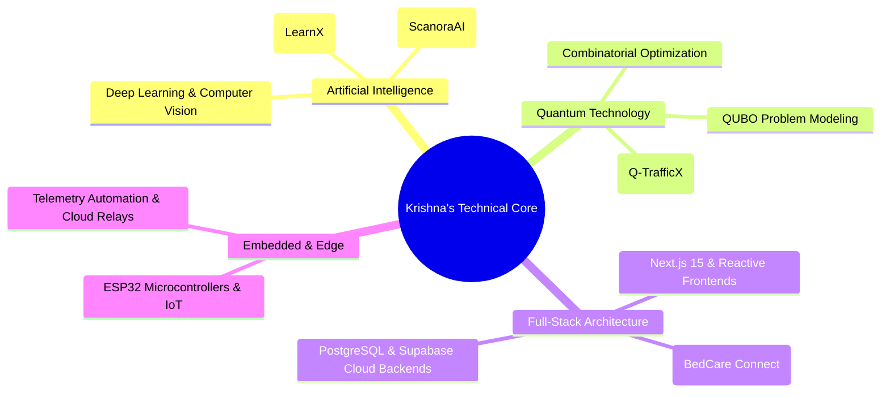

  <!-- Custom Cyberpunk Neon Hero Banner -->
  

    

  <!-- Dynamic Typing SVG in Cyber Cyan -->
  

  

    <strong>AI/ML &amp; Full-Stack Developer | CSE Student | Quantum Technology Minor | Building Intelligent Solutions 🚀</strong>
  

  <!-- Status Badges in Cyan & Pink Accents -->
  

    
    
  

  <!-- Social Links Bar -->
  

    
    
    
    
  

## ⚡ About Me

I am a computer science student specializing in **Artificial Intelligence & Machine Learning**, with a minor in **Quantum Technology**. Driven by solving mathematically challenging problems, I build intelligent systems that bridge theory with high-performance software.

- 🧠 **Artificial Intelligence & Machine Learning:** Designing predictive pipelines, deep neural architectures, anomaly and fraud detection models, and multi-modal generative AI integrations using modern LLM APIs.
- ⚛️ **Quantum Computing & Optimization:** Exploring quantum algorithms (QAOA, VQE, QUBO problem modeling) and quantum-inspired metaheuristics (simulated annealing, graph optimization) to solve high-dimensional combinatorial problems.
- 💻 **Modern Full-Stack Engineering:** Engineering reactive, cloud-native web and mobile applications using Next.js 15, TypeScript, FastAPI, PostgreSQL, Supabase, and Docker.
- 🌐 **Hardware & IoT Telemetry:** Integrating microcontrollers (ESP32 / Arduino), real-time sensor streams, and cloud dashboards for physical computing and smart automation.
- 🔭 **Current Focus:** Developing hybrid quantum-classical optimization frameworks and intelligent autonomous agents for critical systems.

 

## 🛠️ Technical Arsenal

### 💻 Core Programming Languages

  
  
  
  
  
  
  
  

### 🧠 Artificial Intelligence & Machine Learning

  
  
  
  
  
  
  
  

### ⚛️ Quantum Computing & Computational Optimization

  
  
  
  
  

### 🚀 Full-Stack & Cloud Architecture

  
  
  
  
  
  
  
  

### 🛠️ DevOps, Embedded & Engineering Tools

  
  
  
  
  
  

 

## 🌟 Featured Engineering Projects

| Project | Tech Stack | Highlights | Links |
| :--- | :--- | :--- | :---: |
| 🔬 **ScanoraAI** | `PyTorch` `Computer Vision` `Medical Imaging` `Explainable AI` `Python` | • Deep-learning-based knee MRI abnormality and tear detection • Medical image analysis focusing on diagnostic feature extraction • Explainability maps designed to highlight clinical regions of interest | `[Repo Pending]` |
| 🚦 **Q-TrafficX** | `Python` `Quantum-Inspired Optimization` `QUBO` `Simulation` `Algorithms` | • Quantum-inspired simulation for urban congestion and priority vehicle routing • Combinatorial optimization modeling for adaptive traffic signal flow • **Recognized at the Quantexa Hackathon** for innovative algorithmic design | `[Repo Pending]` |
| 🧠 **LearnX** | `Next.js` `TypeScript` `Google Gemini` `Supabase` `Tailwind CSS` | • AI-powered personalized platform supporting adaptive learning paths • Dynamic topic decomposition into structured knowledge visualizations • Automated contextual quiz generation and performance retention tracking | `[Repo Pending]` |
| 🏥 **BedCare Connect** | `Next.js 15` `TypeScript` `Supabase` `Google Gemini` `Capacitor` | • Multi-tenant healthcare management: Caretakers, Patients, Families, Admins • Gemini AI clinical note summarization and care coordination workflows • Offline-first accessibility with progressive caching and mobile readiness |   |

 

## 🔬 Research & Exploration Horizons

 

## 🤝 Let's Connect & Collaborate

Whether you are interested in collaborating on an **AI/ML project**, discussing **Quantum Computing algorithms**, exploring **Full-Stack innovations**, or simply connecting with fellow builders:

  
  &nbsp;
  
  &nbsp;
  
  &nbsp;
  

    
  
  

    <em>"The best way to predict the future is to invent it with clean code, principled algorithms, and quantum curiosity."</em>
  

  

    ⭐ <strong>If you found something interesting here, feel free to star the repositories!</strong>
  

